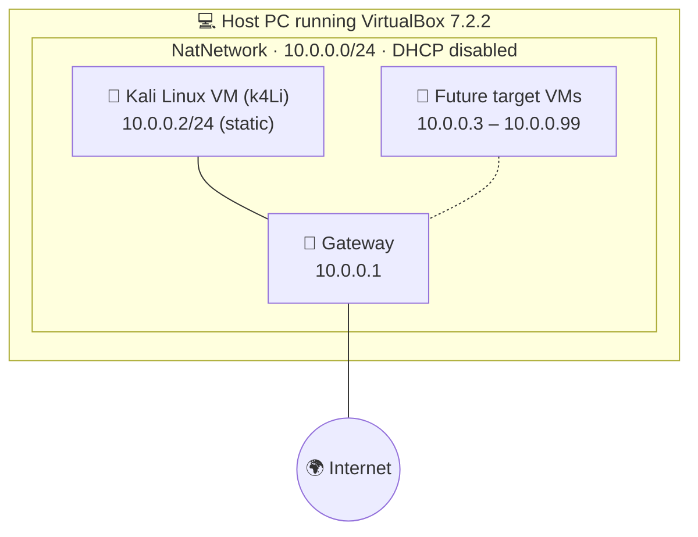
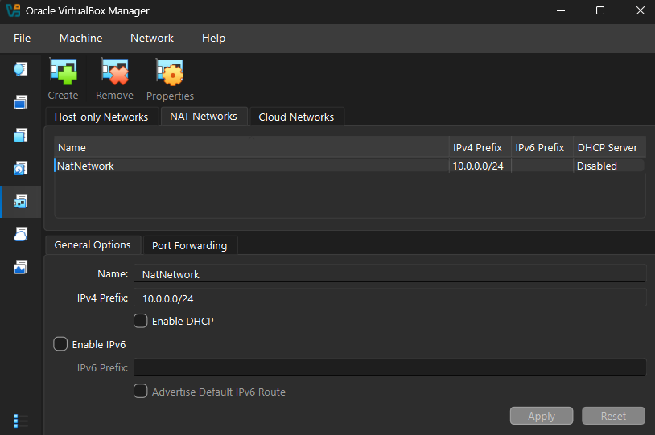
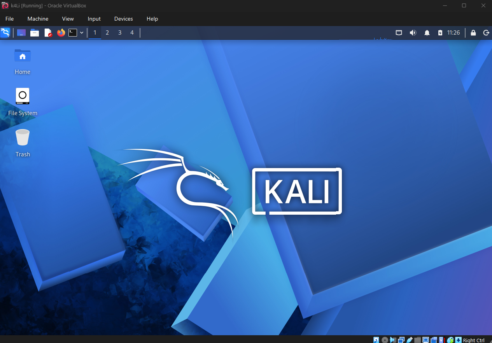
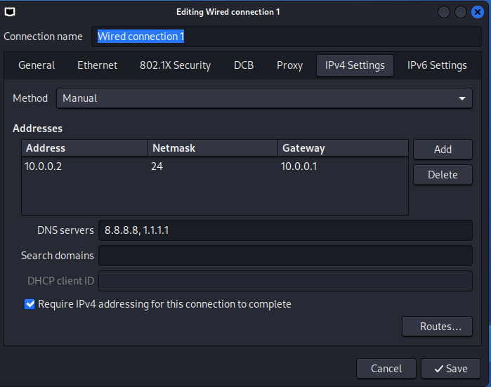

<div align="center">

# 🐉 Cybersecurity Home Lab: VirtualBox + Kali Linux

### Week 01 · Project 01 — Isolated lab for ethical hacking practice


-E87500?style=for-the-badge)


**by Ghalib Farras Ahmad**

</div>

---

## 📖 Table of Contents

1. [Summary](#-summary)
2. [Goals](#-goals)
3. [Topology](#-topology)
4. [Lab Specification](#-lab-specification)
5. [Build Walkthrough](#-build-walkthrough)
6. [Verification Checklist](#-verification-checklist)
7. [Troubleshooting Notes](#-troubleshooting-notes)
8. [Key Takeaways](#-key-takeaways)
9. [Rules of Engagement](#-rules-of-engagement)
10. [References](#-references)
11. [About the Author](#-about-the-author)

---

## 📝 Summary

This repository documents how I built a self-contained penetration-testing lab on my own computer. The lab runs **Kali Linux** inside **VirtualBox** and sits on a private **NAT Network** (`10.0.0.0/24`).

Everything stays inside the host machine, so I can scan, probe, and break things without touching any real network. Because the network is shared, I can later add more virtual machines (as targets) and Kali will be able to reach them.

> 💡 **In one line:** one attacker VM, one private network, a static IP, and a clean snapshot to return to whenever something goes wrong.

---

## 🎯 Goals

By the end of this project I wanted to have:

- [x] VirtualBox installed and working as the hypervisor
- [x] Kali Linux imported as a VM
- [x] A dedicated NAT Network created for the lab
- [x] Kali connected to that network with a fixed IPv4 address
- [x] Connectivity and DNS tested
- [x] A clean snapshot saved as a restore point
- [x] The whole process documented, with screenshots

---

## 🗺️ Topology

The diagram below shows the lab as I built it. Future VMs will join the same network and use the reserved range.



The course also provides a reference topology that lists the optional machines planned for later weeks (Windows 11, Windows 10, Windows 7, Windows Server 2016, and an Android device), each with its own address in the same `10.0.0.0/24` network:

<p align="center">
  
  <br>
  <sub><i>Reference topology from the course material</i></sub>
</p>

---

## ⚙️ Lab Specification

| Item | Value |
| :--- | :--- |
| **Hypervisor** | VirtualBox 7.2.2 (latest release at the time of setup) |
| **Guest OS** | Kali Linux (`TODO: release, e.g. 2026.x`) |
| **VM name** | `k4Li` |
| **Network type** | NAT Network (`NatNetwork`) |
| **Network range** | `10.0.0.0/24` |
| **DHCP on NatNetwork** | Disabled (static addressing only) |
| **IPv6** | Disabled |
| **Kali IP** | `10.0.0.2/24` (manual) |
| **Gateway** | `10.0.0.1` |
| **DNS servers** | `8.8.8.8`, `1.1.1.1` |
| **Reserved for new VMs** | `10.0.0.3` – `10.0.0.99` |

---

## 🛠️ Build Walkthrough

### 1️⃣ Install the tools

Two programs are needed on the host before anything else:

- **VirtualBox**, the hypervisor that runs the VMs.
- **7-Zip**, because the prebuilt Kali VM image is usually shipped as a compressed `.7z` archive.

### 2️⃣ Create the NAT Network

In VirtualBox I opened **Network Manager → NAT Networks** and created a new network with these settings:

| Setting | Value |
| :--- | :--- |
| Name | `NatNetwork` |
| IPv4 Prefix | `10.0.0.0/24` |
| Enable DHCP | ☐ Off |
| Enable IPv6 | ☐ Off |

<p align="center">
  
  <br>
  <sub><i>NatNetwork in VirtualBox Network Manager (note the DHCP column: Disabled)</i></sub>
</p>

**Why a NAT Network and not plain NAT?** With plain NAT every VM is isolated from the others, and each one only talks to the outside. A NAT Network puts several VMs on the *same* private segment, so they can talk to each other and still reach the internet through the host. That is exactly what an attacker-and-target lab needs.

**Why is DHCP off?** I wanted full control over addressing. Without a DHCP server, nothing receives an address automatically, so every VM gets a manually assigned IP. It keeps the lab predictable and makes the IP plan easy to document.

### 3️⃣ Import Kali Linux

I downloaded the official Kali VirtualBox image, extracted it with 7-Zip, and imported it into VirtualBox. Then I attached the VM to the lab network:

```text
Settings → Network → Adapter 1
  Enable Network Adapter : ✔
  Attached to            : NAT Network
  Name                   : NatNetwork
```

I also set up a shared folder so I can move files between the host and the VM.

<p align="center">
  
  <br>
  <sub><i>Kali Linux (VM <code>k4Li</code>) booted and running</i></sub>
</p>

### 4️⃣ Give Kali a static IP

Inside Kali, I edited the wired connection through NetworkManager (**Edit Connections → Wired connection 1 → IPv4 Settings**) and switched the method from Automatic to **Manual**:

| Field | Value |
| :--- | :--- |
| Method | Manual |
| Address | `10.0.0.2` |
| Netmask | `24` (255.255.255.0) |
| Gateway | `10.0.0.1` |
| DNS servers | `8.8.8.8, 1.1.1.1` |

<p align="center">
  
  <br>
  <sub><i>Static IPv4 configuration in Kali's NetworkManager</i></sub>
</p>

A fixed address means Kali is always found at the same place, which keeps future scans, notes, and screenshots consistent.

### 5️⃣ Save a clean snapshot

With the network working, I took a VirtualBox snapshot (**Machine → Take Snapshot**) so I always have a known-good state to roll back to.

```text
Suggested name: Clean Kali - Network Setup
```

If a later experiment breaks the VM, I can restore this snapshot instead of rebuilding from scratch.

---

## ✅ Verification Checklist

Run these inside the Kali terminal after setup, and after restoring the snapshot, to confirm everything works.

| # | What it checks | Command | Expected result |
| :-: | :--- | :--- | :--- |
| 1 | Interface has the right address | `ip a` | `10.0.0.2/24` on the Ethernet interface |
| 2 | Default route points to the gateway | `ip route` | `default via 10.0.0.1` |
| 3 | Gateway is reachable | `ping -c 4 10.0.0.1` | Replies received |
| 4 | Internet is reachable (by IP) | `ping -c 4 8.8.8.8` | Replies received |
| 5 | DNS works | `nslookup networkwalks.com` | Name resolves to an IP |
| 6 | Pentest tooling is present | `nmap --version` | Version banner printed |
| 7 | Snapshot restores cleanly | Restore snapshot, then `ip a` | Same static IP as before |

Quick way to run the network checks in one go:

```bash
ip -br a && ip route && ping -c 2 10.0.0.1 && ping -c 2 8.8.8.8 && nslookup networkwalks.com
```

---

## 🧯 Troubleshooting Notes

Two problems are common with this setup. Documenting them here saves time for anyone repeating the lab.

<details>
<summary><b>🌐 No internet after setting a manual IP</b></summary>

<br>

Depending on the Kali / NetworkManager version, the connection can stall or fail after switching to a manual address. Disabling the duplicate-address-detection delay is a known workaround:

```bash
# 1. Find the real connection name first
nmcli connection show

# 2. Apply the fix (replace the name if yours is different)
sudo nmcli connection modify "Wired connection 1" ipv4.dad-timeout 0

# 3. Restart the connection
sudo nmcli connection down "Wired connection 1" && sudo nmcli connection up "Wired connection 1"
```

Then re-run the checklist above. If it still fails, reboot the VM.

> Connection names differ between machines. Always confirm yours with `nmcli connection show` before running the commands.

</details>

<details>
<summary><b>🖥️ VM will not start: VT-x / virtualization error</b></summary>

<br>

This means hardware virtualization is switched off in the firmware. To fix it:

1. Restart the PC and open the BIOS/UEFI setup.
2. Enable **Intel VT-x** (or **AMD-V** on AMD CPUs).
3. Save and exit.
4. Boot the host OS, then start the VM again.

If the error persists on a Windows host, features such as Hyper-V or Windows Hypervisor Platform can also compete with VirtualBox for virtualization, so check those too.

</details>

---

## 🧠 Key Takeaways

- **NAT vs NAT Network.** Plain NAT isolates each VM; a NAT Network lets VMs share one private segment *and* reach the internet. Only the latter suits a multi-machine lab.
- **No DHCP means no automatic IPs.** Turning DHCP off pushed me to plan the address space (`.2` for Kali, `.3–.99` for future VMs) instead of letting it be random.
- **Static addressing in Kali.** I practiced setting address, prefix length, gateway, and DNS in NetworkManager, and verifying each with `ip` and `ping`.
- **Snapshot early.** The best time to snapshot is *before* risky work, while the system is still clean.
- **Write it down.** Commands, screenshots, and the problems I hit are part of the deliverable, not an afterthought.

---

## ⚖️ Rules of Engagement

This lab exists for **learning and authorized testing only**.

- Only scan or attack systems **I own** or have **written permission** to test.
- Keep lab traffic inside `NatNetwork`; do not aim tools at the host network or the internet.
- Unauthorized access to systems is illegal, whatever the intent.

---

## 🔗 References

| Tool | Link |
| :--- | :--- |
| 7-Zip | <https://7-zip.org/download.html> |
| VirtualBox | <https://virtualbox.org/wiki/Downloads> |
| Kali Linux | <https://kali.org/get-kali> |

---

## 👤 About the Author

**Ghalib Farras Ahmad**
Cybersecurity student, Networkwalks batch **B084E**

GitHub: [@nanonanonuggat](https://github.com/nanonanonuggat)

<sub>Program: Cybersecurity at Networkwalks · Week 01 · Project 01: Cybersecurity & Pentesting Lab Setup</sub>
